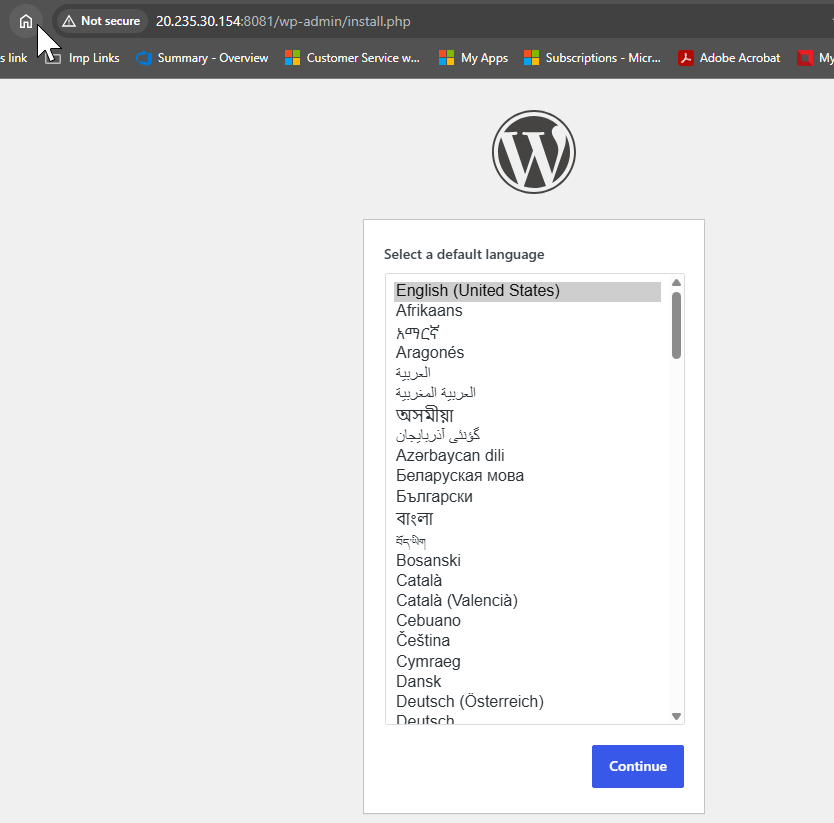
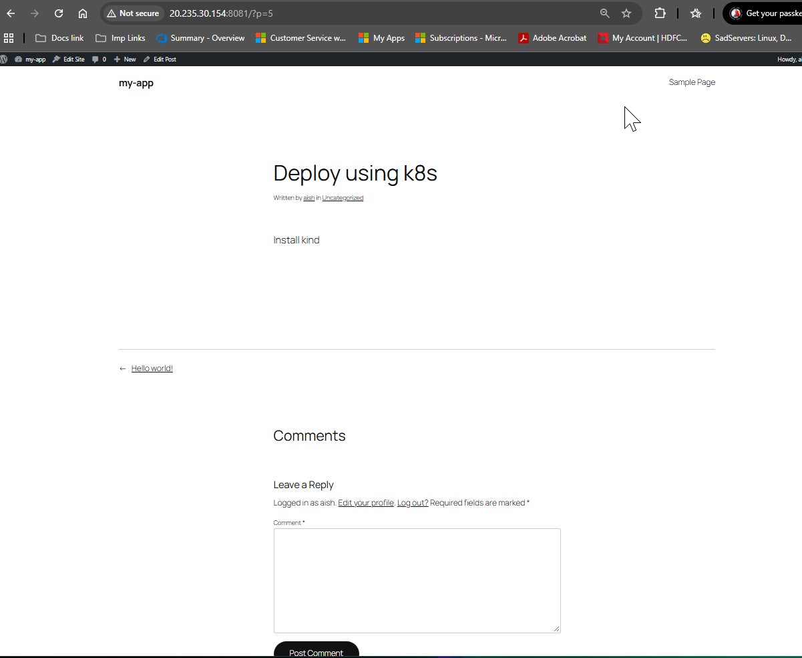

# Day 60 – Capstone: Deploy WordPress + MySQL on Kubernetes

### Task 1: Create the Namespace (Day 52)
1. Create a `capstone` namespace
2. Set it as your default: `kubectl config set-context --current --namespace=capstone`
```sh
azureuser@Tws-lab:~$ kubectl create namespace capstone
namespace/capstone created
azureuser@Tws-lab:~$ kubectl config set-context --current --namespace=capstone
Context "kind-kind" modified.
azureuser@Tws-lab:~$ kubectl get ns
NAME                 STATUS   AGE
capstone             Active   31s
```

---

### Task 2: Deploy MySQL (Days 54-56)
1. Create a Secret with `MYSQL_ROOT_PASSWORD`, `MYSQL_DATABASE`, `MYSQL_USER`, and `MYSQL_PASSWORD` using `stringData`
```sh
apiVersion: v1
kind: Secret
metadata:
  name: mysql-secret
type: Opaque
stringData:
  MYSQL_ROOT_PASSWORD: admin
  MYSQL_DATABASE: wordpress
  MYSQL_PASSWORD: pswd@123
  MYSQL_USER: sqluser
```
2. Create a Headless Service (`clusterIP: None`) for MySQL on port 3306
```sh
azureuser@Tws-lab:~/capstone-proj$ cat service.yaml
apiVersion: v1
kind: Service
metadata:
  name: mysql-service
spec:
  selector:
    app: sql-app
  type: ClusterIP
  ports:
    - name: http
      protocol: TCP
      port: 3306
      targetPort: 3306
  clusterIP: None
```
3. Create a StatefulSet for MySQL with:
   - Image: `mysql:8.0`
   - `envFrom` referencing the Secret
   - Resource requests (cpu: 250m, memory: 512Mi) and limits (cpu: 500m, memory: 1Gi)
   - A `volumeClaimTemplates` section requesting 1Gi of storage, mounted at `/var/lib/mysql`
```sh
apiVersion: apps/v1
kind: StatefulSet
metadata:
  name: sql-set
spec:
  serviceName: "mysql-service"
  replicas: 1
  selector:
    matchLabels:
      app: sql-app
  minReadySeconds: 10
  template:
    metadata:
      labels:
        app: sql-app
    spec:
      terminationGracePeriodSeconds: 10
      containers:
        - name: mysql
          image: mysql:8.0
          ports:
            - containerPort: 3306
              name: sql
          volumeMounts:
          - name: sqlvol          # The 'name' here must match the 'metadata.name' in volumeClaimTemplates below
            mountPath: /var/lib/mysql
          # Injecting all keys from the Secret as environment variables
          envFrom:
          - secretRef:
              name: mysql-secret
          resources:
            requests:
              cpu: 250m
              memory: 512Mi
            limits:
              cpu: 500m
              memory: 1Gi
# This is the blueprint for creating PVCs dynamically per pod replica
  volumeClaimTemplates:
  - metadata:
      name: sqlvol
    spec:
      accessModes: [ "ReadWriteOnce" ]
      storageClassName: "standard"
      resources:
        requests:
          storage: 1Gi
```
4. Verify MySQL works: `kubectl exec -it mysql-0 -- mysql -u <user> -p<password> -e "SHOW DATABASES;"`

```sh
azureuser@Tws-lab:~/capstone-proj$ kubectl get all
NAME            READY   STATUS              RESTARTS   AGE
pod/sql-set-0   0/1     ContainerCreating   0          6s

NAME                    TYPE        CLUSTER-IP   EXTERNAL-IP   PORT(S)    AGE
service/mysql-service   ClusterIP   None         <none>        3306/TCP   20s

NAME                       READY   AGE
statefulset.apps/sql-set   0/1     6s

azureuser@Tws-lab:~/capstone-proj$ kubectl exec -it sql-set-0 -- mysql -u root -padmin -e "SHOW DATABASES;"
mysql: [Warning] Using a password on the command line interface can be insecure.
+--------------------+
| Database           |
+--------------------+
| information_schema |
| mysql              |
| performance_schema |
| sys                |
| wordpress          |
+--------------------+
```

**Verify:** Can you see the `wordpress` database? -> yes

#### Why do we use Headless service with mysql:
- We use a headless service (configured with clusterIP: None) because a standard Kubernetes service randomly load-balances traffic, which breaks databases where pods have distinct roles like a primary writer or read-only replicas. By removing the single cluster IP, a headless service forces Kubernetes to create predictable, stable DNS records for each individual pod (e.g., sql-set-0.mysql-service), allowing your application or database cluster orchestration tools to discover and connect directly to the exact MySQL instance they need without accidental routing or data inconsistency.

- A headless service is not mandatory to make a StatefulSet run, but it is highly recommended if your application needs to talk to specific pods by their index (like pod-0, pod-1). You can absolutely use headless services with Deployments and other workloads as well. When used with a Deployment, a headless service bypasses the single load-balancer IP and returns the raw IP addresses of all running pods during a DNS lookup, which is perfect for microservices that want to handle their own client-side load balancing or service discovery.

---

### Task 3: Deploy WordPress (Days 52, 54, 57)
1. Create a ConfigMap with `WORDPRESS_DB_HOST` set to `mysql-0.mysql.capstone.svc.cluster.local:3306` and `WORDPRESS_DB_NAME`
```sh
apiVersion: v1
kind: ConfigMap
metadata:
  name: myconfigmap
data:
  WORDPRESS_DB_HOST: "sql-set-0.mysql-service.capstone.svc.cluster.local:3306"
  WORDPRESS_DB_NAME: "wordpress"
```

2. Create a Deployment with 2 replicas using `wordpress:latest` that:
   - Uses `envFrom` for the ConfigMap
   - Uses `secretKeyRef` for `WORDPRESS_DB_USER` and `WORDPRESS_DB_PASSWORD` from the MySQL Secret
   - Has resource requests and limits
   - Has a liveness probe and readiness probe on `/wp-login.php` port 80

```sh
apiVersion: apps/v1
kind: Deployment
metadata:
  name: wordpress-app
  labels:
    app: wp-app
spec:
  replicas: 2
  selector:
    matchLabels:
      app: wp-app
  template:
    metadata:
      labels:
        app: wp-app
    spec:
      containers:
      - name: wp-app
        image: wordpress:latest
        ports:
        - containerPort: 80
        envFrom:
          - configMapRef:
              name: myconfigmap
        env:
        # Secret References (secretKeyRef)
        - name: WORDPRESS_DB_USER
          valueFrom:
            secretKeyRef:
              name: mysql-secret
              key: MYSQL_USER
        - name: WORDPRESS_DB_PASSWORD
          valueFrom:
            secretKeyRef:
              name: mysql-secret
              key: MYSQL_PASSWORD
        resources:
          requests:
            cpu: 500m
            memory: 500Mi
          limits: 
            cpu: 800m
            memory: 1Gi
        livenessProbe:
          httpGet:
            path: /wp-login.php
            port: 80
          initialDelaySeconds: 120
          periodSeconds: 15
          timeoutSeconds: 5
          failureThreshold: 3
        readinessProbe:
          httpGet:
            path: /wp-login.php
            port: 80
        initialDelaySeconds: 60
          periodSeconds: 10
          timeoutSeconds: 5
          failureThreshold: 3
```

3. Wait until both pods show `1/1 Running`

**Verify:** Are both WordPress pods running and ready?
```sh
azureuser@Tws-lab:~/capstone-proj$ kubectl get po
NAME                             READY   STATUS    RESTARTS   AGE
sql-set-0                        1/1     Running   0          4m32s
wordpress-app-7d55f57589-qtnzn   1/1     Running   0          4m25s
wordpress-app-7d55f57589-w97jj   1/1     Running   0          4m25s
```

---

### Task 4: Expose WordPress (Day 53)
1. Create a NodePort Service on port 30080 targeting the WordPress pods
```sh
azureuser@Tws-lab:~/capstone-proj$ cat nodeport.yaml
apiVersion: v1
kind: Service
metadata:
  name: wp-nodeport
spec:
  type: NodePort
  selector:
    app: wp-app
  ports:
  - port: 80
    targetPort: 80
    nodePort: 30080
```
2. Access WordPress in your browser:
   - Minikube: `minikube service wordpress -n capstone`
   - Kind: `kubectl port-forward svc/wordpress 8080:80 -n capstone`
3. Complete the setup wizard and create a blog post

**Verify:** Can you see the WordPress setup page?
```sh
azureuser@Tws-lab:~$ curl -I http://localhost:8080
HTTP/1.1 302 Found
Date: Thu, 15 Oct 2026 18:20:04 GMT
Server: Apache/2.4.68 (Debian)
X-Powered-By: PHP/8.3.35
Expires: Wed, 11 Jan 1984 05:00:00 GMT
Cache-Control: no-cache, must-revalidate, max-age=0, no-store, private
X-Redirect-By: WordPress
Location: http://localhost:8080/wp-admin/install.php
Content-Type: text/html; charset=UTF-8

azureuser@Tws-lab:~/capstone-proj$ kubectl port-forward --address 0.0.0.0 svc/wp-nodeport 8081:80
Forwarding from 0.0.0.0:8081 -> 80
Handling connection for 8081
Handling connection for 8081
```



---

### Task 5: Test Self-Healing and Persistence
1. Delete a WordPress pod — watch the Deployment recreate it within seconds. Refresh the site.
2. Delete the MySQL pod: `kubectl delete pod mysql-0 -n capstone` — watch the StatefulSet recreate it
3. After MySQL recovers, refresh WordPress — your blog post should still be there

**Verify:** After deleting both pods, is your blog post still there? -> yes

---

### Task 6: Set Up HPA (Day 58)
1. Write an HPA manifest targeting the WordPress Deployment with CPU at 50%, min 2, max 10 replicas
```sh
apiVersion: autoscaling/v2
kind: HorizontalPodAutoscaler
metadata:
  name: wp-hpa
spec:
  scaleTargetRef:
    apiVersion: apps/v1
    kind: Deployment
    name: wordpress-app
  minReplicas: 2
  maxReplicas: 10
  metrics:
  - type: Resource
    resource:
      name: cpu
      target:
        type: Utilization
        averageUtilization: 50
```
2. Apply and check: `kubectl get hpa -n capstone`
```sh
azureuser@Tws-lab:~/capstone-proj$ kubectl get hpa
NAME     REFERENCE                     TARGETS              MINPODS   MAXPODS   REPLICAS   AGE
wp-hpa   Deployment/wp-wordpress-app   cpu: <unknown>/50%   2         10        0          7s
```
3. Run `kubectl get all -n capstone` for the complete picture
```sh
azureuser@Tws-lab:~/capstone-proj$ kubectl get all -o wide
NAME                                 READY   STATUS    RESTARTS   AGE     IP            NODE           NOMINATED NODE   READINESS GATES
pod/sql-set-0                        1/1     Running   0          7m14s   10.244.2.12   kind-worker2   <none>           <none>
pod/wordpress-app-7d55f57589-7kmkp   1/1     Running   0          6m15s   10.244.2.13   kind-worker2   <none>           <none>
pod/wordpress-app-7d55f57589-qtnzn   1/1     Running   0          42m     10.244.1.7    kind-worker    <none>           <none>

NAME                    TYPE        CLUSTER-IP     EXTERNAL-IP   PORT(S)        AGE   SELECTOR
service/mysql-service   ClusterIP   None           <none>        3306/TCP       26h   app=sql-app
service/wp-nodeport     NodePort    10.96.171.13   <none>        80:30080/TCP   38m   app=wp-app

NAME                            READY   UP-TO-DATE   AVAILABLE   AGE   CONTAINERS   IMAGES             SELECTOR
deployment.apps/wordpress-app   2/2     2            2           42m   wp-app       wordpress:latest   app=wp-app

NAME                                       DESIRED   CURRENT   READY   AGE   CONTAINERS   IMAGES             SELECTOR
replicaset.apps/wordpress-app-7d55f57589   2         2         2       42m   wp-app       wordpress:latest   app=wp-app,pod-template-hash=7d55f57589

NAME                       READY   AGE   CONTAINERS   IMAGES
statefulset.apps/sql-set   1/1     42m   mysql        mysql:8.0

NAME                                         REFERENCE                  TARGETS              MINPODS   MAXPODS   REPLICAS   AGE
horizontalpodautoscaler.autoscaling/wp-hpa   Deployment/wordpress-app   cpu: <unknown>/50%   2         10        2          98s

azureuser@Tws-lab:~/capstone-proj$ kubectl run -it --rm load-generator   --image=curlimages/curl   --restart=Never   -n capstone   -- /bin/sh -c 'while true; do curl -s -o /dev/null http://wp-nodeport:80; done'
All commands and output from this session will be recorded in container logs, including credentials and sensitive information passed through the command prompt.
If you don't see a command prompt, try pressing enter.

azureuser@Tws-lab:~/capstone-proj$ kubectl get hpa -w
NAME     REFERENCE                  TARGETS         MINPODS   MAXPODS   REPLICAS   AGE
wp-hpa   Deployment/wordpress-app   cpu: 128%/50%   2         10        5          2d15h
wp-hpa   Deployment/wordpress-app   cpu: 132%/50%   2         10        5          2d15h
wp-hpa   Deployment/wordpress-app   cpu: 128%/50%   2         10        5          2d15h
wp-hpa   Deployment/wordpress-app   cpu: 131%/50%   2         10        5          2d15h
wp-hpa   Deployment/wordpress-app   cpu: 84%/50%    2         10        5          2d15h
wp-hpa   Deployment/wordpress-app   cpu: 53%/50%    2         10        5          2d15h

```

**Verify:** Does the HPA show correct min/max and target? -> Yes

---

### Task 7: (Bonus) Compare with Helm (Day 59)
1. Install WordPress using `helm install wp-helm bitnami/wordpress` in a separate namespace
```sh
azureuser@Tws-lab:~/capstone-proj$ kubectl config set-context --current --namespace=helm-space
Context "kind-kind" modified.
azureuser@Tws-lab:~/capstone-proj$ helm install wp-helm bitnami/wordpress
NAME: wp-helm
LAST DEPLOYED: Sun Oct 18 10:32:05 2026
NAMESPACE: helm-space
STATUS: deployed
REVISION: 1
DESCRIPTION: Install complete
TEST SUITE: None
NOTES:
CHART NAME: wordpress
CHART VERSION: 34.1.3
APP VERSION: 7.1.3
``
2. Compare: how many resources did each approach create? Which gives more control?
```sh
azureuser@Tws-lab:~/capstone-proj$ kubectl get all
NAME                                     READY   STATUS    RESTARTS   AGE
pod/wp-helm-mariadb-0                    1/1     Running   0          74s
pod/wp-helm-wordpress-8486f8dfd7-hqp67   1/1     Running   0          74s

NAME                               TYPE           CLUSTER-IP      EXTERNAL-IP   PORT(S)                      AGE
service/wp-helm-mariadb            ClusterIP      10.96.75.135    <none>        3306/TCP                     75s
service/wp-helm-mariadb-headless   ClusterIP      None            <none>        3306/TCP                     75s
service/wp-helm-wordpress          LoadBalancer   10.96.163.174   <pending>     80:31298/TCP,443:32123/TCP   75s

NAME                                READY   UP-TO-DATE   AVAILABLE   AGE
deployment.apps/wp-helm-wordpress   1/1     1            1           74s

NAME                                           DESIRED   CURRENT   READY   AGE
replicaset.apps/wp-helm-wordpress-8486f8dfd7   1         1         1       74s

NAME                               READY   AGE
statefulset.apps/wp-helm-mariadb   1/1     74s

HPA - kubectl run -it --rm load-generator   --image=curlimages/curl   --restart=Never   -n capstone   -- /bin/sh -c 'while true; do curl -s -o /dev/null http://wp-helm-wordpress; done'

azureuser@Tws-lab:~/capstone-proj$ kubectl run load-generator \
  --image=curlimages/curl \
  --restart=Never \
  -- /bin/sh -c '
while true; do
  curl -s -o /dev/null http://wp-helm-wordpress:80/
done'
pod/load-generator created

azureuser@Tws-lab:~/capstone-proj$ kubectl get hpa -w
NAME          REFERENCE                      TARGETS         MINPODS   MAXPODS   REPLICAS   AGE
wp-helm-hpa   Deployment/wp-helm-wordpress   cpu: 150%/50%   1         6         3          10m
wp-helm-hpa   Deployment/wp-helm-wordpress   cpu: 148%/50%   1         6         3          10m
wp-helm-hpa   Deployment/wp-helm-wordpress   cpu: 150%/50%   1         6         3          10m
wp-helm-hpa   Deployment/wp-helm-wordpress   cpu: 144%/50%   1         6         3          11m
wp-helm-hpa   Deployment/wp-helm-wordpress   cpu: 74%/50%    1         6         3          11m
```
```
wp-helm
│
├── WordPress
│   ├── Deployment
│   │    └── ReplicaSet
│   │          └── WordPress Pod
│   │
│   └── LoadBalancer Service
│
└── MariaDB
    ├── StatefulSet
    │    └── MariaDB Pod
    │
    ├── ClusterIP Service
    └── Headless Service

Two different traffic flows
USER → WordPress
WordPress → MariaDB
```
#### Complete application flow
                    USER
                     │
                     │ HTTP
                     ↓
         wp-helm-wordpress Service
             LoadBalancer
          10.96.163.174:80
                     │
                     ↓
              WordPress Pod
    wp-helm-wordpress-8486f8dfd7-hqp67
                     │
                     │ Database query
                     │ TCP 3306
                     ↓
           wp-helm-mariadb Service
             10.96.75.135:3306
                     │
                     ↓
              MariaDB Pod
          wp-helm-mariadb-0
                     │
                     ↓
              Database data

3. Clean up the Helm deployment

---

### Task 8: Clean Up and Reflect
1. Take a final look: `kubectl get all -n capstone`
2. Count the concepts you used: Namespace, Secret, ConfigMap, PVC, StatefulSet, Headless Service, Deployment, NodePort Service, Resource Limits, Probes, HPA, Helm — twelve concepts in one deployment
3. Delete the namespace: `kubectl delete namespace capstone`
4. Reset default: `kubectl config set-context --current --namespace=default`

**Verify:** Did deleting the namespace remove everything? -> Yes

---

## Hints
- If MySQL takes long to start, check: `kubectl logs mysql-0 -n capstone`
- `WORDPRESS_DB_HOST` must match the StatefulSet DNS pattern: `<pod>.<service>.<namespace>.svc.cluster.local`
- WordPress probes may fail initially — `initialDelaySeconds` gives it time to boot
- If PVC stays Pending, check `kubectl get storageclass`
- `nodePort` must be in range 30000-32767
- The Bitnami chart uses MariaDB instead of MySQL — compatible but not identical